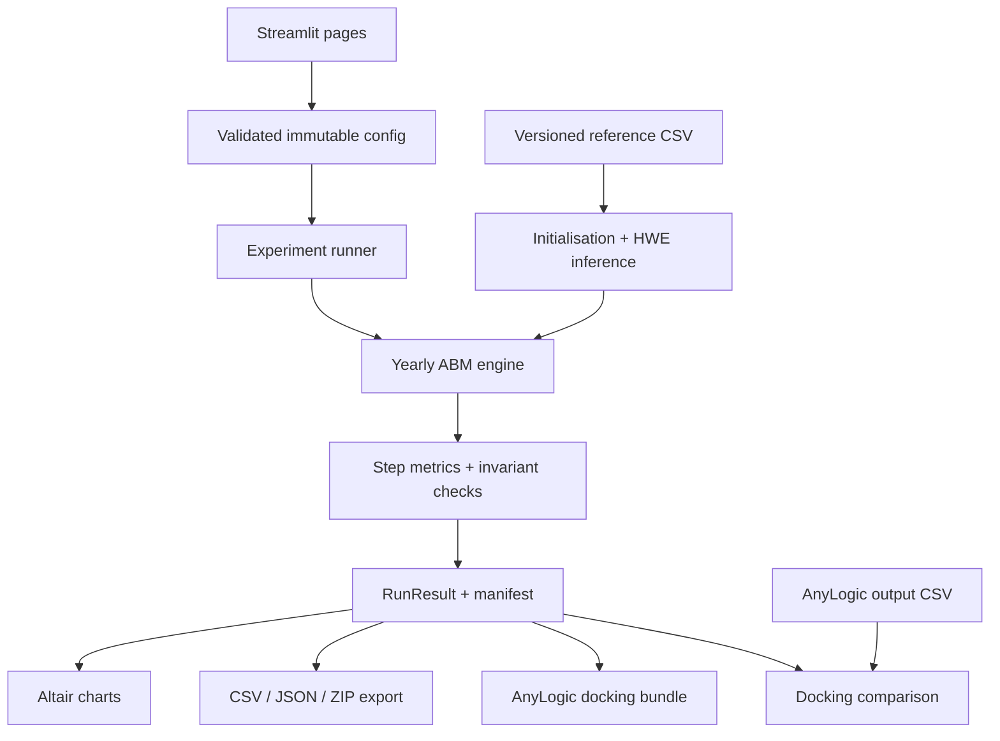

# BloodTypeLab

## TU Wien Modeling & Simulation 2026: Project Proposal and Python Web Application Specification

**Topic:** Evolution of Blood Types (Blood Types)
**Institution:** Technische Universität Wien (TU Wien)
**Status:** **Proposal for instructor discussion, not yet approved.** A working reference implementation exists (see Section 24).
**Document version:** 1.1, refined 11 November 2026
**Audience:** Course instructor, four-person student team, Python implementation team
**Primary implementation:** Python agent-based simulation (NumPy) with a multi-page Streamlit web interface
**AnyLogic:** File-based "docking" bridge implemented; native AnyLogic re-implementation optional (Section 19)

> **Project in one sentence:** Build a reproducible, time-stepped agent-based model in Python that simulates the inheritance and changing distribution of ABO (and simplified RhD) blood types in a synthetic population initialised from a sourced Austrian reference; compare a no-shock baseline with at least two external shocks and with explicit fitness hypotheses; expose every experiment through a local Streamlit application with exports, verification evidence and an AnyLogic cross-validation bridge.

**Important:** This document separates (a) what the supplied TU Wien documents require, (b) what the team proposes, and (c) what is already implemented. Nothing here claims supervisor approval.

---

## What changed in v1.1 (versus v1.0)

| # | Change | Reason |
|---|---|---|
| 1 | The brief **does** define a simplified Rhesus model ("+ and − exist, + dominant", single locus). RhD is therefore an *in-scope, switchable* executable module, not only literature. | Re-reading `blood_type.pdf`, p. 1 |
| 2 | The brief states allele 1 comes from the father, allele 2 from the mother. The engine stores alleles in that order (parent-of-origin bookkeeping); phenotype is order-independent. | `blood_type.pdf`, p. 1 |
| 3 | Added a **sourced Austrian reference**: A 41 %, B 15 %, AB 7 %, O 37 %; Rh+ 81 %, Rh− 19 % (Gesundheitsportal, Austrian Federal Ministry, updated 21 Dec 2022). ABO × Rh joint distribution assumes independence (documented). | Section 8 |
| 4 | Fixed the event chronology (mortality uses age at start of the year, then ageing, then births). v1.0 ordering skipped infant mortality. | Section 9 |
| 5 | Added concrete, literature-anchored fitness mechanisms: phenotype-dependent survival/fecundity multipliers and **Rh maternal–fetal incompatibility (HDN)**, a documented heterozygote-disadvantage mechanism. | Task 2 asks for fitness rules |
| 6 | Added a third, neutral shock (**bottleneck/catastrophe**) to separate drift effects from selection effects. | Interpretation of shocks |
| 7 | Hardy–Weinberg genotype inference via **maximum-likelihood EM** (plus Bernstein closed form) with reported residuals. | Section 8.2 |
| 8 | Paired comparison design with **common random numbers** for initial populations and seed-paired differences. | Section 10.6 |
| 9 | Performance architecture: *structure-of-arrays* agents (NumPy) with a frozen `Agent` dataclass view. Same individual-level rules, ~100× faster than Python objects. | Replicated experiments need speed |
| 10 | AnyLogic section rewritten with four concrete integration levels, licence caveats, a CSV contract and a statistical docking test. | User request + group question 4 |
| 11 | Answered the group's DES question: the brief asks for an ABM with equidistant steps; a separate DES is not required. AnyLogic docking provides the "model comparison" the group asked about. | `List of questions…pdf` |
| 12 | Literature section corrected: the brief's "O first, then A and B" narrative conflicts with molecular evidence (O alleles are loss-of-function variants of the A/B transferase; ABO is a trans-species polymorphism). | Scientific caution |

---

## Quick navigation

- **Instructor:** Sections 1–6 and 19.
- **Developers / coding agents:** Sections 7–18, 20 and 24.
- **Report writers:** Sections 8, 10–12, 21 and 23.

---

# Part I. The original problem and our proposed solution

## 1. Source documents and official requirements

1. `blood_type.pdf`, *Evolution of Blood Types*, 3 pages. Subject specification.
2. `ProjectTopics_ModSim2026.pdf`, 52 pages. Course-wide requirements, grading, presentation schedule; Blood Types on p. 20.
3. `List of questions for the first meeting.pdf`, 1 page. The group's preliminary supervisor questions.

### 1.1 Original problem (as stated in the brief)

- Each human carries **two ABO alleles** (A, B, O); the **first is inherited from the father, the second from the mother**.
- O is recessive, A and B are codominant → phenotypes A, B, AB, O.
- "Analogously" the **Rhesus factor** sits on one locus with alleles **+** and **−**, **+ dominant**.
- The brief recommends a **microscopic (agent-based) model**:
  1. fix an initial number of individuals with genotype and sex;
  2. iterate through time in **equidistant steps**, picking random individuals;
  3. each individual has a death probability, possibly **phenotype-dependent**;
  4. each individual has a chance to reproduce with a randomly chosen partner of the **opposite sex**; the child gets one random allele from each parent;
  5. at **predefined times**, external **shock events** change the population.

### 1.2 The four assignment tasks

| Task | Requirement | Source |
|---|---|---|
| 1. Literature review | Evolution of blood types **and** Rhesus factor | `blood_type.pdf` p. 3 |
| 2. Evolutionary model | Start from approximate Austrian distribution; find rules for how blood type influences **fitness**; experimenting with modelling ideas encouraged | p. 3 |
| 3. External shocks | **At least two different types** (e.g. mass immigration, illness attacking one blood type) compared with a **no-shock baseline** | p. 3 |
| 4. Written protocol | Document findings | p. 3 |

Any fundamental language is allowed (Python, MATLAB, Java). AnyLogic, Streamlit, a GUI and a database are **not** required.

### 1.3 Course-wide obligations

- Groups of four; topic registration 6 Nov 2026 12:00 – 13 Nov 2026 12:00.
- At least **two supervisor meetings**.
- Blood Types presentation session: **Fri 22 January 2027, 12:10–16:00**.
- Final report upload: **8 February 2027**.
- Graded: model credibility, documentation/results, scientific writing, code, completeness, presentation; pass conditions for originality, submission, lecture test, individual contribution.

The application never replaces the report, code submission or presentation.

### 1.4 What the sources do **not** settle

- Whether executable Rh is compulsory (the brief *describes* a model for it; scope still to confirm).
- Mutation operator and rate.
- Forward simulation from today vs. historical reconstruction.
- Genotype frequencies behind phenotype percentages.
- Fitness coefficients, fertility/mortality rates, age structure, mating rules, migration intensities.
- Population size, time-step unit, horizon, replicate count, accepted validation evidence.
- Whether a separate DES model is expected.

**Policy:** project choices are never presented as instructor requirements. Open items are tracked in Section 6 and `docs/decisions_from_supervisor.md`.

## 2. Objective and research questions

**Problem statement.** Observed blood-type distributions are the aggregate outcome of individual inheritance, birth, death and migration. We model the individuals explicitly to see which processes can move the aggregate.

The model is **educational and explanatory**, not an epidemiological or demographic forecast.

**Research questions**

1. Does the individual-based model reproduce Mendelian ABO/RhD inheritance?
2. How does a neutral, no-shock population evolve (genetic drift, Hardy–Weinberg stability)?
3. How sensitive are results to population size, the hidden-genotype inference and demographic assumptions?
4. How does an immigration shock change genotype, allele and phenotype distributions relative to the paired baseline?
5. How does a blood-type-dependent disease shock change them? How does it compare with a phenotype-*neutral* bottleneck of similar mortality?
6. Which fitness rules (survival, fecundity, maternal–fetal incompatibility) produce directional change, on what time scale, and how strong must they be to exceed drift?

These are questions, not promised findings; models are never tuned to manufacture a trend.

## 3. Deliverables and scope

### 3.1 Deliverables

| Deliverable | Classification | Evidence |
|---|---|---|
| ABO/Rh literature review | Required | `docs/literature_review.md` → report chapter |
| Individual-based evolutionary model | Required | `bloodtypelab/` package, tests, reproducible runs |
| Austrian starting distribution | Required | `data/references/austria_abo_rh.csv` + inference method |
| Fitness investigation | Required | Selection presets, sensitivity runs, report chapter |
| ≥ 2 external shocks + baseline | Required | Immigration, disease (+ bottleneck), paired comparisons |
| Written protocol | Required | Final report |
| Presentation, code, contributions | Course-wide | Slides, repository, `group_contributions.md` |
| Streamlit application | Team addition | 8-page local app |
| Automated tests and exports | Engineering method | pytest, manifests, CSV/JSON, SHA-256 hashes |
| AnyLogic docking bridge | Optional addition | Export/import CSV contract + statistical comparison |

### 3.2 Scientific MVP

- Agents with paternal/maternal ABO alleles and (switchable) RhD alleles, sex, age.
- Correct inheritance and genotype→phenotype mapping.
- Initialisation from a **versioned, attributed** Austrian reference with declared HWE inference and reported residuals.
- One-year time step; explicit age-dependent mortality and fertility; optional density regulation.
- Neutral baseline; explicit fitness hypotheses; disabled-by-default mutation.
- Immigration, disease and bottleneck shocks.
- Replicated, seeded, paired experiments with uncertainty bands.
- Invariant checks every step; reproducibility tests.

### 3.3 Application MVP

Overview · Genetics Lab · Population Explorer · Simulation Studio · Scenario Comparison · Validation & Evidence · AnyLogic Bridge · Methods & References.

### 3.4 Not in scope

Full molecular Rh (RHD/RHCE haplotypes, weak D, partial D), other blood-group systems, real patient data, clinical predictions, hosted SaaS, authentication, databases, FastAPI services, LLM agents.

## 4. Instructor demo (5–7 minutes)

1. **Overview** — tasks → features map, provenance labels.
2. **Genetics Lab** — Punnett square for `AO × BO`, 10 000 simulated births vs theory.
3. **Population Explorer** — Austrian reference → HWE allele frequencies → 5 000 agents; target vs realised.
4. **Simulation Studio** — 150-year baseline; stacked phenotype area chart; invariant badge.
5. **Scenario Comparison** — baseline vs immigration vs disease vs bottleneck, 10 paired seeds, mean ± 95 % band, differences in percentage points.
6. **Validation** — run the live verification suite (real results, no pre-filled ticks).
7. **AnyLogic Bridge** — export the docking bundle; show how an AnyLogic output is compared statistically.
8. **Discussion** — open decisions (Section 6).

Synthetic demographic profiles are always labelled **Illustrative, uncalibrated**.

## 5. Why Python, NumPy and Streamlit

- Python is explicitly allowed; transparent, testable, free.
- ABM matches the brief's microscopic model; the time-stepped scheduler matches "equidistant steps".
- NumPy *structure-of-arrays* keeps each person an individual record (row) while running 10 000+ agents × 200 years × dozens of replicates in seconds.
- Streamlit gives a browser UI for parameters, runs, plots and downloads with no server infrastructure.
- Local-first: no network, no accounts, reproducible on the supervisor's laptop.

## 6. Decisions to confirm with the supervisor

| Decision | Proposed default | Why it matters |
|---|---|---|
| Executable genetics | ABO + simplified single-locus RhD (switchable) | The brief describes Rh as "+ dominant"; confirm whether executable Rh is expected |
| Objective | Forward simulation from present-day Austria | Modern frequencies cannot reconstruct origins |
| Genotype inference | Hardy–Weinberg MLE (EM), residuals reported; sensitivity with alternatives | Phenotypes do not determine genotypes |
| ABO × Rh joint | Independence (product of marginals) | Source gives marginals only |
| Time model | 1-year steps, 100–300-year horizon | Brief says equidistant, unit unspecified |
| Demography | Gompertz–Makeham mortality, Gaussian fertility schedule, TFR 2.1, density regulation toward carrying capacity — *illustrative* | Must be coherent with time unit |
| Fitness | Neutral baseline + hypothesis presets (survival RR, fecundity weights, Rh-HDN) | Task 2 |
| Mutation | Operator implemented, rate 0 by default | Brief discusses mutation without defining it |
| Shocks | Immigration + phenotype-specific disease (+ neutral bottleneck control) | Both examples in the brief |
| Framework | Python ABM + Streamlit | Python allowed |
| DES / AnyLogic | Not required; optional docking cross-validation | Avoid duplicated validation work |
| Validation | Mendelian tests, invariants every step, reproducibility, replicate uncertainty, sensitivity, optional docking | Model credibility grade |
| Hand-in | Report, code, slides; app as supporting artefact | Confirm exact format |

**Decision rule:** irreversible scientific assumptions only after approval; clearly labelled demos are fine before.

---

# Part II. Scientific simulation specification

## 7. Agents

An **agent** is one simulated person — an ordinary data record, not an AI.

### 7.1 Attributes

| Field | Type | Notes |
|---|---|---|
| `agent_id` | int ≥ 0 | Unique, never reused |
| `sex` | `F`/`M` | Simplified reproductive pairing model, not a model of gender |
| `age` | int (years) | Age at start of the current year |
| `abo_paternal`, `abo_maternal` | `A`/`B`/`O` | Order = parent of origin, as stated in the brief |
| `rh_paternal`, `rh_maternal` | `D`/`d` | `D` = Rh+ allele (dominant), `d` = Rh− allele |
| `birth_step` | int | Negative for initial agents |
| `rh_sensitized` | bool | Female only; set after an Rh+ pregnancy when HDN module is on |

**Implementation:** a `Population` object stores each attribute as a NumPy array (one row per living agent). `Population.agent(i)` returns a frozen `Agent` dataclass for inspection and export. Dead agents are removed (not kept in a growing list).

### 7.2 ABO genetics

| Genotype | Phenotype |
|---|---|
| AA, AO | A |
| BB, BO | B |
| AB | AB |
| OO | O |

Canonical genotype strings are ordered A < B < O (`AO`, never `OA`). Each child receives one uniformly random allele from each parent. `AO × BO` → AB, AO, BO, OO each with p = 0.25.

### 7.3 Simplified RhD

Single locus, `D` dominant: DD, Dd → Rh+; dd → Rh−. This is the model described in the brief. Real Rh genetics (RHD deletion/variants, RHCE) are covered in the literature review only.

### 7.4 Mutation (extension, off by default)

Each transmitted ABO allele mutates with probability μ per transmission to another allele according to a row-stochastic transition matrix (default: uniform among the other two). μ = 0 by default. Literature per-locus mutation rates are of order 10⁻⁵–10⁻⁶ per generation; at that rate mutation is invisible on a 300-year horizon, so any visible effect requires an explicitly "exaggerated educational" rate.

## 8. Starting population and reference data

### 8.1 Reference dataset

`data/references/austria_abo_rh.csv` (version `at-gesundheitsportal-2022`):

| Phenotype | Share | Source |
|---|---|---|
| A | 0.41 | Gesundheitsportal (gesundheit.gv.at), "Blutgruppenuntersuchung (BGR)", last updated 21 Dec 2022, accessed 11 Nov 2026 |
| B | 0.15 | same |
| AB | 0.07 | same |
| O | 0.37 | same |
| Rh+ | 0.81 | same |
| Rh− | 0.19 | same |

Limitations: rounded to whole percent; population covered is not stated (likely donor/clinical data); ABO × Rh joint distribution not given. The team must verify and, ideally, replace with Austrian Red Cross donor statistics before the final report.

A second dataset, `synthetic_demo`, is explicitly labelled **illustrative, not Austria**.

### 8.2 From phenotypes to genotypes

Implemented methods:

1. **`hwe_em` (default):** maximum-likelihood allele frequencies (p_A, p_B, p_O) under Hardy–Weinberg via the gene-counting EM algorithm; genotype frequencies p², 2pr, … ; residuals between HWE-implied and target phenotype shares reported.
2. **`hwe_bernstein`:** Bernstein's closed-form estimator r = √O, p = 1 − √(B+O), q = 1 − √(A+O), renormalised; reports Bernstein's D = 1 − p − q − r.
3. **`explicit_split`:** user sets the fraction of A phenotypes that are AA and of B that are BB; reproduces phenotype targets exactly; used for sensitivity analysis.

RhD: d = √(Rh− share), D = 1 − d under HWE.

For Austria (EM): p_A ≈ 0.278, p_B ≈ 0.117, p_O ≈ 0.605 (max. phenotype residual ≈ 0.5 percentage points), d ≈ 0.436 — values to be re-derived by the team and quoted from the app's output, not this document.

### 8.3 Initialisation procedure

1. Validate reference shares (non-negative, sum to 1 ± 0.005).
2. Infer genotype frequencies (method above).
3. Assign genotypes by **multinomial sampling** (default) or **quota allocation** (largest remainder; minimises sampling noise).
4. Assign sex (Bernoulli 0.5) and age from the **stationary age distribution** implied by the mortality schedule (survivorship lₓ normalised) — illustrative.
5. Record target vs realised phenotype/genotype/allele shares and seed in the manifest.

The initial population uses its own random stream, so all scenarios with the same seed start from an **identical** population.

## 9. One simulation step (1 year)

Final chronology (implemented, stable):

1. **Immigration**: scheduled immigrants are added with ages from the configured range.
2. **Mortality**: one Bernoulli draw per agent with combined probability
   `q = 1 − (1 − q_base·)(1 − q_disease)(1 − q_bottleneck)` where `q_base·` includes the fitness hazard multiplier (`q' = 1 − (1 − q)^RR`, which stays in [0, 1]). Deaths are attributed to causes by partitioning the same uniform draw (base → disease → bottleneck), giving *excess* deaths per cause.
3. **Ageing**: survivors age +1.
4. **Reproduction**: each eligible female (age in [15, 49]) gives birth with probability `f(age) × w_fecundity(phenotype) × regulation`, capped at 1, at most one child per year. The father is drawn from eligible males (age in [15, 64]) with probability ∝ fecundity weight. Child alleles: paternal allele = random allele of father, maternal allele = random allele of mother; optional mutation; RhD analogously.
5. **Rh-HDN (optional)**: if the mother is Rh− and **sensitised** and the child is Rh+, the pregnancy is lost with probability `p_hdn` (counted as `fetal_losses`, not as births). After any Rh+ pregnancy an Rh− mother becomes sensitised.
6. **Newborns** are added with age 0; they cannot reproduce in the year of birth.
7. **Metrics and invariants** are recorded.

**Regulation (optional, default on):** `regulation = (K / N)^η`, with carrying capacity K (default: initial size) and strength η (default 1). It keeps population size roughly stationary so frequency changes are not confounded with exponential growth/collapse. It is phenotype-neutral.

### 9.1 Invariants (checked every step)

- `N_end = N_start + immigrants + births − deaths − emigrants` (emigrants = 0 currently).
- Genotype counts sum to N; allele counts sum to 2N; phenotype counts sum to N.
- All probabilities in [0, 1]; all shares in [0, 1]; non-empty share vectors sum to 1 ± 1e-9.
- Unique agent IDs; valid alleles; non-negative ages.
- No birth from a dead or ineligible parent (enforced structurally: parents are drawn only from survivors in the eligible age window).
- Empty populations are handled (shares become NaN, run stops with a warning "population extinct").

### 9.2 Demographic profile `illustrative_uncalibrated`

| Parameter | Value | Status |
|---|---|---|
| Mortality | Gompertz–Makeham μ(x) = a + b·e^{c·x}, a = 5·10⁻⁴, b = 1.6·10⁻⁵, c = 0.1; q₀ = 0.004; max age 105 | Illustrative (life expectancy ≈ 80 y) |
| Fertility | Gaussian schedule, mean 30, sd 5.5, ages 15–49, scaled to TFR 2.1 | Illustrative |
| Male reproductive ages | 15–64 | Illustrative |
| Density regulation | K = N₀, η = 1 | Modelling device |

Austrian calibration (Statistik Austria life tables, TFR ≈ 1.3–1.5) is a possible extension; with low TFR, regulation or immigration is needed to keep N stable.

## 10. Baseline, fitness, mutation and shocks

### 10.1 Baseline

Neutral selection, no shocks, regulation on. Expected: phenotype shares fluctuate by drift with variance ≈ p(1−p)·t/(2Nₑ); no systematic trend.

### 10.2 Fitness (Task 2)

**Working definition:** fitness = relative survival (annual hazard multiplier `RR_survival`) × relative fecundity (`w_fecundity`) per ABO phenotype (and optionally per Rh phenotype), plus the maternal–fetal Rh incompatibility mechanism.

Presets (all labelled):

| Preset | Rule | Status |
|---|---|---|
| Neutral | All 1 | Control |
| O survival advantage | RR(O) = 0.95 | **Hypothetical**, loosely motivated by malaria-protection literature (not applicable to Austria) |
| A survival disadvantage | RR(A) = 1.05 | **Hypothetical** |
| B fecundity advantage | w(B) = 1.05 | **Hypothetical** |
| Rh-HDN (pre-prophylaxis) | p_hdn = 0.1 for sensitised Rh− mothers carrying Rh+ fetuses | Mechanism documented in literature; magnitude hypothetical |

Analysis: directional change vs. replicate band; time to detectable change; selection-strength sweep (Section 12.2).

### 10.3 Mutation

See 7.4; zero-rate test verifies no mutation events.

### 10.4 Shock A — Immigration

At `start_step`, `count` immigrants per year for `duration_steps` years (or a fraction of N). Genotypes drawn under HWE from **source allele frequencies** (presets: "same as residents", "High-B source", "High-O source" — all **hypothetical**), ages uniform in [min, max], sex 50/50.

### 10.5 Shock B — Phenotype-dependent disease

From `start_step` for `duration_steps` years, affected ABO phenotypes (and optionally Rh) get either a relative risk on the annual hazard (`relative_risk`) or an additional independent death probability (`additional_probability`). Combination as in Section 9 step 2. **Hypothetical; no medical claim.**

### 10.6 Shock C — Bottleneck (neutral control)

At `start_step`, every agent dies with an extra probability `fraction` regardless of phenotype. Separates drift/founder effects from selection.

### 10.7 Experimental design

- Experiment 0: baseline. 1: immigration. 2: disease. 3: bottleneck. 4: fitness presets.
- Same seeds across scenarios → identical initial populations (common random numbers); differences are computed **per seed** then summarised (paired design).
- Report mean and empirical 2.5/97.5 percentiles across replicates (≥ 10, ideally 30+).

## 11. Metrics

| Metric | Unit |
|---|---|
| Population size; births; deaths by cause; immigrants; fetal losses | people / year |
| ABO phenotype shares (A, B, AB, O) | fraction (CSV), % (plots) |
| Genotype shares (AA, AO, BB, BO, AB, OO) | fraction |
| Allele shares (A, B, O; D, d) | fraction |
| Rh+ share; combined ABO×Rh shares (8 types) | fraction |
| Observed vs HWE-expected heterozygosity (ABO) | fraction |
| Mean age | years |
| Scenario − baseline | percentage points |
| Replicate dispersion | 2.5/97.5 percentile band |

The UI labels data as **Observed reference**, **Inferred**, **Simulated** or **Hypothetical**.

## 12. Verification and validation

### 12.1 Verification (implemented as pytest + live in-app suite)

| Test | Expectation |
|---|---|
| OO × OO; AA × OO | 100 % OO; 100 % AO |
| AO × OO; AB × OO; AO × BO | 50/50; 50/50; 25 % each (χ² test, n = 20 000, α = 0.001) |
| Dd × Dd | 25 % dd |
| Invalid genotype | `ValueError` |
| μ = 0 | zero mutation events |
| No shocks / zero-magnitude shocks | identical to baseline output |
| Accounting | invariant holds every step |
| Reproducibility | same config + seed → identical tables |
| HWE inference | recovers known allele frequencies from exact HWE phenotypes |

### 12.2 Validation (scientific credibility)

- Initial phenotypes vs Austrian reference (residuals shown).
- Neutral baseline: no drift beyond expected binomial variance; HWE heterozygosity maintained.
- Sensitivity: N, inference method, TFR, regulation, selection strength, shock size.
- Optional **docking** with an independent AnyLogic implementation (Section 19).
- Outputs are *implications of assumptions*, not predictions.

---

# Part III. Implementation

## 13. Technology and architecture

| Layer | Choice |
|---|---|
| Language | Python 3.12 (tested) |
| Agents | NumPy structure-of-arrays + frozen `Agent` dataclass view |
| Randomness | `numpy.random.SeedSequence` → separate streams for initialisation, dynamics, immigration |
| Scheduler | Explicit yearly loop (`engine.step`) |
| Tables | pandas |
| Charts | Altair / Vega-Lite via `st.altair_chart` (follows the app theme; fixed colour-blind-safe phenotype colours). Chosen over Plotly per Streamlit 1.67 guidance. |
| UI | Streamlit multipage (`st.navigation`) with custom theme |
| Tests | pytest + Streamlit `AppTest` smoke test |

No FastAPI, database, cloud, login or API keys.



**Boundaries:** core never imports Streamlit; UI never re-implements genetics; configs are frozen snapshots; completed runs are immutable; reference data is read-only; failed runs never replace successful ones; export folders are written as `.partial` and renamed on success.

### 13.1 Repository

```text
BloodTypeLab/
├── README.md
├── BloodTypeLab_Refined_Project_Proposal_and_Implementation_Spec.md
├── requirements.txt / requirements-lock.txt / pyproject.toml
├── app.py                         # Streamlit entry (st.navigation)
├── setup_windows.bat, run_local.bat
├── .streamlit/config.toml         # theme
├── bloodtypelab/
│   ├── genetics.py   agents.py   config.py   reference.py
│   ├── initialization.py   demography.py   selection.py   shocks.py
│   ├── engine.py   metrics.py   experiments.py   validation.py
│   ├── exports.py   anylogic_bridge.py
├── ui/  theme.py  charts.py  controls.py  state.py
├── app_pages/  overview, genetics_lab, population, simulation,
│               comparison, validation, anylogic, methods   (registered via st.navigation)
├── data/references/austria_abo_rh.csv, synthetic_demo.csv, sources.md
├── data/demo/demo_config.json
├── scripts/run_baseline.py, run_experiments.py, export_anylogic_bundle.py
├── anylogic/README.md, java_snippets/*.java
├── tests/
├── docs/ literature_review.md, model_specification.md, assumptions_register.md,
│         experiment_plan.md, decisions_from_supervisor.md, final_report_outline.md,
│         anylogic_integration.md
└── results/                       # gitignored
```

## 14. Interfaces

```python
# genetics.py
canonical_genotype(a1, a2) -> str
phenotype_from_genotype(genotype) -> str
inherit_genotype(parent_1: str, parent_2: str, rng) -> str
offspring_distribution(parent_1, parent_2) -> dict[str, float]   # exact theory

# reference.py / initialization.py
load_reference(reference_id) -> ReferenceData
infer_genotype_frequencies(reference, method, **kw) -> InferenceResult
initialize_population(config, reference, rng) -> InitializationResult

# engine.py
simulate(config, progress=None) -> RunResult

# experiments.py
run_replicates(config, seeds) -> list[RunResult]
run_scenario_batch(base_config, scenarios, seeds) -> BatchResult
summarize_replicates(runs, metric) -> DataFrame       # mean, p2.5, p97.5
paired_differences(batch, scenario, metric) -> DataFrame

# validation.py / exports.py / anylogic_bridge.py
validate_run(run) -> ValidationReport
run_verification_suite() -> list[CheckResult]
export_run(run, directory) -> Path
export_anylogic_bundle(config, directory) -> Path
compare_with_anylogic(anylogic_df, python_runs) -> DockingReport
```

### 14.1 Configuration (JSON)

```json
{
  "schema_version": "1.1",
  "initial_population": 5000,
  "horizon_steps": 150,
  "seed": 20261111,
  "reference_id": "austria_gesundheitsportal_2022",
  "initialization_method": "hwe_em",
  "allocation": "multinomial",
  "include_rh": true,
  "demography": {"profile_id": "illustrative_uncalibrated", "tfr": 2.1, "regulation": true},
  "selection": {"preset": "neutral"},
  "mutation": {"rate": 0.0},
  "shocks": []
}
```

### 14.2 Exports

| File | Columns |
|---|---|
| `population_timeseries.csv` | run_id, scenario, seed, step, population, births, deaths, deaths_natural, deaths_disease, deaths_bottleneck, immigrants, emigrants, fetal_losses, mean_age |
| `phenotype_timeseries.csv` | run_id, scenario, seed, step, phenotype, count, share |
| `genotype_timeseries.csv` | … genotype, count, share |
| `allele_timeseries.csv` | … allele, count, share |
| `rh_timeseries.csv` | … rh_phenotype, count, share |
| `manifest.json` | schema/model version, config snapshot, reference metadata, seeds, run id, status, warnings, files + SHA-256 |
| `validation_summary.json` | invariant results per check, failures |

`share` is a fraction in [0, 1].

## 15. Application pages

| Page | Purpose | Key elements |
|---|---|---|
| Overview | Explain assignment & app | Task→feature map, provenance legend, demo journey, disclaimer |
| Genetics Lab | Inheritance | Parent pickers, Punnett square, theory vs n simulated births, χ² |
| Population Explorer | Initial population | Reference → inference → agents; residuals; age pyramid; agent sample table |
| Simulation Studio | Single run | `st.form` controls, shocks builder, KPI cards, stacked area, allele lines, population & events, invariant badge, downloads |
| Scenario Comparison | Paired replicates | Scenario toggles, replicates, mean ± band per scenario, Δ vs baseline (pp), final-step distribution, CSV/ZIP |
| Validation & Evidence | Verification + credibility | Live suite (real execution), optional pytest run, drift-vs-theory check |
| AnyLogic Bridge | Interoperability | Export bundle, upload AnyLogic CSV, docking test |
| Methods & References | Documentation | Event order, parameter glossary, assumptions register, decisions, bibliography |

Interaction standards: drafts separate from completed runs; charts render completed runs only; consistent phenotype colours (A, B, AB, O) with labels, never colour alone; helpful empty states; actionable errors.

## 16. Reproducibility and state

Run lifecycle: draft → validate → frozen config → run id → init → steps (+ invariants) → result → export (`.partial` → final). Resource limits: N ≤ 200 000, horizon ≤ 1 000, `N × steps × replicates ≤ 5·10⁸` agent-years; requests above are rejected with an explanation, never silently truncated.

## 17. Windows setup

```bat
setup_windows.bat     :: creates .venv if missing, installs pinned deps, runs smoke tests
run_local.bat         :: starts Streamlit on 127.0.0.1
```

Manual: `py -3.12 -m venv .venv`, `.venv\Scripts\python -m pip install -r requirements.txt`, `.venv\Scripts\python -m pytest -q`, `.venv\Scripts\python -m streamlit run app.py --server.address 127.0.0.1`.

## 18. Phases and gates

| Phase | Build | Gate |
|---|---|---|
| 0 | Repo, README, docs skeleton, assumptions register | Tests run on every machine |
| 1 | Genetics | Deterministic + χ² crosses pass |
| 2 | Init + neutral engine | Invariants every step; reproducible |
| 3 | Fitness, shocks, experiments | Baseline + ≥ 2 shocks comparable; zero-effect controls pass |
| 4 | Streamlit | Full demo journey without code edits |
| 5 | Packaging, AnyLogic bridge | Clean install works; bundle exports |
| 6 | Report & presentation | Every figure reproducible from manifest |

### 18.1 Work split (four students)

| Workstream | Owns |
|---|---|
| Genetics & evidence | `genetics.py`, `reference.py`, `initialization.py`, literature review |
| ABM & demography | `engine.py`, `demography.py`, `selection.py` |
| Experiments & validation | `shocks.py`, `experiments.py`, `validation.py`, sensitivity study, AnyLogic docking |
| App & docs | `ui/`, exports, setup scripts, report integration |

Everyone must be able to defend the whole model.

---

# Part IV. AnyLogic and supervisor discussion

## 19. AnyLogic integration

**Short answer: yes, AnyLogic can be integrated, and the most valuable form is *docking* (model-to-model cross-validation), which also answers the group's question "Will we make models comparison?".** AnyLogic cannot execute our Python agent classes natively, so any "integration" means either exchanging data or calling across process boundaries.

### 19.1 Options

| Level | Mechanism | Effort | Licence / risk | Recommendation |
|---|---|---|---|---|
| **1. File-based docking** | Python exports an *AnyLogic bundle* (initial agents CSV, parameters, mortality/fertility tables, shock schedule). An AnyLogic ABM (agent type `Person`, yearly cyclic event) reads it via its Excel/CSV database import, runs, writes yearly counts CSV. The app uploads that CSV and tests whether AnyLogic trajectories fall within the Python replicate band. | Medium (the AnyLogic model must be built by hand) | Works with Personal Learning Edition (PLE); PLE limits model size/runtime | **Recommended** — implemented on the Python side |
| **2. Pypeline** (AnyLogic library) | AnyLogic calls a local Python interpreter (e.g. `bloodtypelab.reference` for HWE inference or `genetics.inherit_genotype`) | Low–medium | Free library; adds a per-call overhead, so call Python for setup/analysis, not per birth | Optional demo |
| **3. Alpyne** | Python drives an exported AnyLogic model (step, observe, set parameters) | Medium | Requires a model export supported by the installed AnyLogic edition — check before committing | Exploratory only |
| **4. AnyLogic Cloud API** | Python client runs uploaded models remotely and fetches outputs | Medium | Needs AnyLogic Cloud account + API key; network dependency; conflicts with local-first rule | Not recommended for the core |

### 19.2 Docking protocol (implemented in Python)

1. `Export bundle` (app page or `scripts/export_anylogic_bundle.py`) writes:
   - `agents.csv` — `agent_id,sex,age,abo_paternal,abo_maternal,rh_paternal,rh_maternal`
   - `parameters.csv` — key/value
   - `mortality_table.csv` — `age,q`
   - `fertility_table.csv` — `age,f`
   - `shocks.csv` — `kind,start_step,duration_steps,param,value`
   - `README_ANYLOGIC.md` + Java snippets for `Person` inheritance and the yearly event.
2. The AnyLogic model writes `anylogic_output.csv`: `step,population,n_A,n_B,n_AB,n_O[,n_rh_pos]` (one row per year, optionally a `replicate` column).
3. The app aligns steps, computes Python replicate bands (same config, ≥ 20 seeds), and reports per-phenotype:
   - share of steps where AnyLogic lies inside the 95 % band (expect ≈ 95 %);
   - final-step z-score versus the Python replicate distribution;
   - if AnyLogic has ≥ 5 replicates: two-sample Kolmogorov–Smirnov test on final shares.
4. Disagreement → inspect chronology, age convention, fertility caps (most docking failures are scheduling differences, not genetics).

Detailed AnyLogic build steps: `docs/anylogic_integration.md`.

### 19.3 Approval question

> We propose a time-stepped ABM in Python with a Streamlit interface; report and code are submitted independently of the dashboard. Optionally, we would re-implement the core model in AnyLogic and dock it against the Python model as a cross-validation. Is that acceptable, or is AnyLogic (or a separate DES) expected?

### 19.4 First-meeting agenda

1. Executable Rh: is the brief's single-locus +/− model sufficient?
2. Mutation: random operator acceptable, or must it be biologically motivated? (Proposed: implemented, off by default, rate sweep as sensitivity.)
3. System boundary: Austria, closed population plus explicit migration shocks? Time scale (1-year steps, 100–300 years)?
4. Fitness: which rules need literature support vs hypothetical sweeps?
5. Shocks: immigration + phenotype-specific disease (+ neutral bottleneck) acceptable?
6. DES: why would DES be needed? (Our answer: the brief's model is ABM with equidistant steps; DES not planned.) Is AnyLogic docking welcome as the "model comparison"?
7. Validation evidence and hand-in format.

Record answers in `docs/decisions_from_supervisor.md`.

### 19.5 Pitch

> We implement the Evolution of Blood Types project as a Python agent-based model. Every person carries paternal and maternal ABO and RhD alleles; the model simulates yearly mortality, reproduction with Mendelian inheritance, and shocks. It starts from the Austrian distribution published by the Austrian health portal (A 41 %, B 15 %, AB 7 %, O 37 %, Rh− 19 %) with Hardy–Weinberg genotype inference, compares a neutral baseline with immigration, phenotype-specific disease and a neutral bottleneck, and studies explicit fitness hypotheses including Rh maternal–fetal incompatibility. A Streamlit app runs paired replicated experiments, shows verification results and exports reproducible data; an optional AnyLogic re-implementation can be docked against it.

---

# Part V. Acceptance, reporting and references

## 20. Definition of done

### 20.1 Science
- [x] Individual ABO genotypes (paternal/maternal) and optional RhD.
- [x] Six canonical genotypes, four phenotypes, correct mapping.
- [x] Mendelian inheritance; deterministic and χ² crosses pass.
- [x] Austrian reference with provenance; HWE inference; residuals reported.
- [x] Yearly ageing, mortality, reproduction.
- [x] Invariants every step.
- [x] Fitness hypotheses (survival, fecundity, Rh-HDN) with transparent parameters.
- [x] Immigration, disease and bottleneck shocks.
- [x] Paired, seeded replicate comparisons with uncertainty bands.
- [ ] Team-verified Austrian source and supervisor-approved assumptions.
- [ ] Sensitivity study and report figures (team).

### 20.2 Application
- [x] Headless engine and CLI scripts.
- [x] 8 pages incl. Validation and AnyLogic Bridge.
- [x] Input validation; immutable completed runs.
- [x] CSV/JSON/ZIP exports with manifest and hashes.
- [x] Verification evidence shown only after it actually runs.
- [x] Windows setup/launch scripts.

### 20.3 Quality
- [x] `pytest` passes: 81 tests incl. headless Streamlit `AppTest` page tests (Python 3.12.10, Windows 11).
- [x] Fixed seed reproduces results in the tested environment.
- [x] No network calls, secrets or personal data.
- [ ] Fresh-machine install tested by a team member.
- [ ] Report, presentation, submission bundle.

## 21. Report structure

Abstract · Objectives · Literature (ABO evolution, Rh, selection evidence) · Model (ODD protocol recommended: Overview, Design concepts, Details — Grimm et al.) · Reference data & initialisation · Demography & fitness assumptions · Shocks & experiment design · Verification · Validation (incl. docking if done) · Results with uncertainty · Sensitivity · Discussion & limitations · Conclusion · Reproducibility appendix (config + seed + model version per figure).

## 22. Implementation-agent instructions

1. Read this spec and the three PDFs; separate requirements from options.
2. Inspect the repository; never overwrite working code, data or results.
3. Keep scientific logic in `bloodtypelab/`; UI only calls it.
4. Never invent rates without labelling them illustrative/hypothetical.
5. Explicit RNG streams; no global random state.
6. Add tests with every module; run them; report real results.
7. Fail safely; preserve last good run.
8. No unnecessary services.
9. A change is done when tests, CLI, exports and UI still work together.
10. State clearly what is implemented, tested, experimental or deferred.

## 23. Sources and provenance

**Supplied:** `blood_type.pdf`; `ProjectTopics_ModSim2026.pdf`; `List of questions for the first meeting.pdf`.

**Reference data:** Gesundheitsportal Österreich, *Blutgruppenuntersuchung (BGR)*, https://www.gesundheit.gv.at/labor/laborwerte/blutgruppenserologie-transfusion/blutgruppenuntersuchung, last updated 21 Dec 2022, accessed 11 Nov 2026.

**Starter bibliography (each must be checked by the team before citing):**
- Landsteiner K. (1901). Discovery of ABO groups. *Wiener klinische Wochenschrift* 14:1132–1134.
- Bernstein F. (1924/1925). Multiple-allele inheritance of ABO groups and the gene-counting estimator.
- Yamamoto F. et al. (1990). Molecular genetic basis of the histo-blood group ABO system. *Nature* 345:229–233.
- Ségurel L. et al. (2012). The ABO blood group is a trans-species polymorphism in primates. *PNAS* 109:18493–18498.
- Wagner F.F., Flegel W.A. (2000). RHD gene deletion occurred in the Rhesus box. *Blood* 95:3662–3668.
- Levine P. et al. (1941). Role of iso-immunization in the pathogenesis of erythroblastosis fetalis. *Am J Obstet Gynecol*.
- Rowe J.A. et al. (2007). Blood group O protects against severe *Plasmodium falciparum* malaria through reduced rosetting. *PNAS* 104:17471–17476.
- Ellinghaus D. et al. (2020). Genomewide association study of severe Covid-19 with respiratory failure. *NEJM* 383:1522–1534.
- Grimm V. et al. (2020). The ODD protocol for describing agent-based and other simulation models: a second update. *JASSS* 23(2):7.
- Axtell R., Axelrod R., Epstein J., Cohen M. (1996). Aligning simulation models: a case study and results. *Computational & Mathematical Organization Theory* 1:123–141.

**Scientific caution:** the brief's sequence "O first, then A and B by mutation" is a simplification. Molecular data show common O alleles are loss-of-function variants of the A/B glycosyltransferase gene, and ABO polymorphism predates the human lineage. Present this nuance in the literature review.

## 24. Implementation status (reference build, 11 Nov 2026)

| Component | Status |
|---|---|
| Genetics (ABO + RhD, mutation operator) | Implemented, tested |
| Reference loader + HWE EM / Bernstein / explicit split | Implemented, tested |
| Engine (immigration, mortality, ageing, reproduction, HDN, regulation) | Implemented, tested |
| Selection presets | Implemented (hypothetical values) |
| Experiments (paired replicates, bands, differences) | Implemented, tested |
| Exports + manifest + hashes | Implemented, tested |
| Streamlit app (8 pages, light/dark theme) | Implemented; every page and main action covered by headless tests; checked in the browser |
| AnyLogic docking bridge (Python side) | Implemented, tested; AnyLogic model itself to be built by the team |
| Austrian demographic calibration | Deferred (illustrative profile only) |
| Supervisor approval | Pending |

---

## Revision log

| Version | Date | Notes |
|---|---|---|
| 1.0 | 11 Nov 2026 | Combined proposal and engineering specification. |
| 1.1 | 11 Nov 2026 | Reference implementation built (see Section 24 and README). Corrections from the brief (Rh model, allele order), sourced Austrian reference, fixed chronology, fitness mechanisms incl. Rh-HDN, bottleneck control, HWE EM inference, paired CRN design, SoA performance architecture, concrete AnyLogic docking, DES answer, literature caution, implementation status. |
